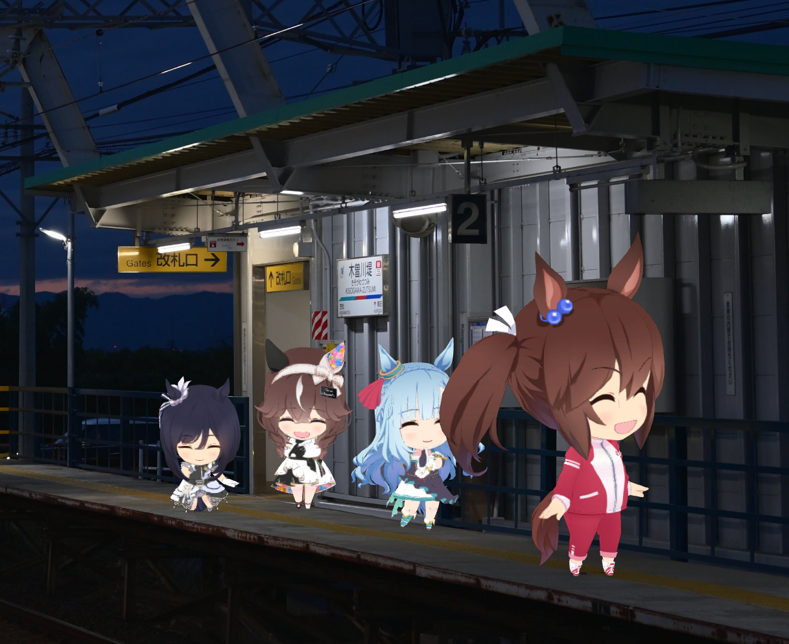

# UmaWalking

  

> **版权与合规 / Copyright / 著作権**
>
> 本项目不直接分发《赛马娘》的角色模型、动作或其他提取后的游戏素材本体。UmaWalking 需要依赖用户自行通过官方客户端下载到本机的游戏数据包；下文说明下载、路径选择和本地精简提取的方法。
>
> Character models, motions, and extracted game-resource packs are not distributed with this project. UmaWalking requires game data that you download locally through the official client. Download and local extraction instructions are provided below.
>
> キャラクターモデル・モーションなど、ゲームから抽出した素材本体は本プロジェクトでは配布しません。公式クライアントから各自のPCにダウンロードしたゲームデータが必要です。取得方法とローカル抽出手順は以下をご覧ください。

**[简体中文](#zh-cn) · [English](#english) · [日本語](#japanese)**

Version **1.0.0** · Windows x64 · Standalone desktop application

## 简体中文

UmaWalking 是基于 [UmaViewer](https://github.com/katboi01/UmaViewer) 开发的实时迷你马娘桌宠。角色直接叠在现有桌面上，与桌面壁纸搭配展示；当前版本不需要 Wallpaper Engine、Unity Editor，运行时也不需要保持游戏客户端开启。

### 获取游戏数据

目前已验证 **日服 DMM 版** 游戏数据获取。需要先安装游戏并完成官方客户端的必要下载，取得完整的本地素材来源：

1. 访问 [《ウマ娘 プリティーダービー》DMM 官方页面](https://dmg.umamusume.jp/)，点击页面右下方的 **「ゲームスタート」**，按提示下载并安装 **DMM GAME PLAYER**。
2. 打开 DMM GAME PLAYER，搜索并下载 **「ウマ娘 プリティーダービー」**。非日本地区用户在打开 DMM GAME PLAYER、连接或进入游戏时，可能需要游戏加速器或代理工具；请遵守当地规定及相关服务条款。
3. 启动游戏，出现 **「追加データをダウンロードします」** 时点击 **OK**，完成约 **18GB** 的首次必要下载。下载量会随游戏版本变化。
4. 记录完整目录 **`游戏安装目录\umamusume_Data\Persistent`**。默认预填 `C:\DMMGames\Umamusume\umamusume_Data\Persistent`；如果安装到其他位置，请选择实际目录。该目录中应能找到 `meta`、`master/master.mdb` 和 `dat`。

**下载后可精简到约600MB。** 在「设置与诊断」中使用「提取迷你角色素材…」，可将所需模型、服装、动作、表情纹理及依赖单独复制到一个空目录；本次验证约647MB／617MiB。程序完成校验并成功切换到精简目录后，会询问是否删除原全量来源数据。确认后原始数据可删除，精简目录要保留；删除会影响原游戏使用。**将来有新模型更新时，仍需通过官方客户端重新下载相应完整来源数据，并重新提取。** 不会自动联网补齐或自动删除原数据。详见 [数据完整性报告](docs/Game-Data-Requirements.md)。

### Features

- 实时渲染用户数据中可完整组装的全部迷你角色，自动随机展示模型、服装及动作。
- 全随机、**Include**（只选这些）、**Exclude**（排除这些）三种模型选择模式，支持多选与跨中日英名称搜索。
- 模型上限可设为 **1～10**，默认6；Include有效名单少于上限时，可用同名角色的不同服装补位，服装不重复。
- 步行／跑步随机循环、各角色独立速度、专属动作穿插播放、表情随动作状态随机选择；支持现有配套双人互动。
- 单击角色可见区域即可立即请求专属动画；支持面板手动指定马娘上场、走向出口退场，以及更换当前服装。
- 支持绘制**一维直线地面与二维平面地面**，对齐壁纸中的道路或平台，实现模型与壁纸的视觉融合；平面模式最多3块凸四边形，各有入口与出口。
- 可用鼠标拖动模型，按住时暂停该角色的动作，松开后恢复；限制在地面内，也能跨地面拖动。
- 出入场和换装渐变、模型尺寸滑块；仅显示在 Explorer 桌面层，桌面完全被应用窗口遮挡时自动暂停。
- **15／30／60／120 FPS**（默认30）、抗锯齿开关、默认关闭的三维地面避让（实验性）、强制重启与诊断文本复制。
- 中／英／日界面，首次按系统语言选择；角色名随界面切换，服装名保留日语。
- 开机自动启动、启动时检查 GitHub 正式版更新、跳过指定版本／所有自动更新，并可随时手动检查；升级保留用户配置。
- **菱曙（ヒシアケボノ / Hishi Akebono）使用普通角色1.5倍的基础显示尺寸**，再叠加统一的模型尺寸滑块。

### 开始使用

1. 在本仓库 **Releases** 下载 `UmaWalking-v1.0.0-Windows-x64.zip`，完整解压到可写的本地目录。
2. 双击 **`Launch-UmaWalking.cmd`**。程序没有游戏数据时会显示控制面板；在「设置与诊断」→「选择数据目录…」选择上文的 `Persistent` 目录，保存后自动重启。
3. 从任务栏或通知区域打开控制面板；关闭面板只会隐藏它。完全结束请点「退出程序」，或按 **Ctrl+Alt+Q**。

运行版无需安装Unity、Python或Wallpaper Engine；开发构建另见 [开发说明](docs/development/Build.md)。

### 操作说明

| 操作 | 使用方法 |
|---|---|
| 选择角色范围 | 「角色与地面」勾选全随机／Include／Exclude；搜索、多选后点击「应用角色范围」。空Include不会随机生成角色。 |
| 调整数量 | 「模型上限数量」选1～10，即时保存。调小时多余角色从出口离开；退场途中可能暂时高于新上限，但不会继续添加超额角色。入场和退场均占名额。 |
| 指定上场／退场 | 从列表选角色并点「指定角色上场」；满员时按顺序排队，待真实空位出现后上场。「立即退场」表示立即走向出口，而非瞬间消失。 |
| 换装／专属动作 | 选中屏幕上的实例后使用换装或动作按钮。同名多实例用服装和实例编号区分。单击模型并松开也可立即请求专属动作。 |
| 拖动与大小 | 按住并拖动模型；模型动作冻结，松开恢复。用「模型大小」滑块统一调整大小。透明区域不会拦截桌面点击。 |
| 直线地面 | 面板选「二维直线」，点「绘制 / 编辑地面」，在半透明画布上依次点击两个端点并保存。它描述一维路径。 |
| 平面地面 | 面板选「三维四点地面」，按远左→远右→近右→近左绘制凸四边形，再在边缘各点两次设入口和出口。可添加最多3块；它描述二维平面的投影。 |
| 性能／语言／数据 | 在「设置与诊断」中选择帧率、抗锯齿、语言及数据目录。避让为实验性功能，默认关闭，仅对平面地面生效。 |
| 暂停／退出／重启 | Ctrl+Alt+P暂停或继续；Ctrl+Alt+N让最早入场者离场；Ctrl+Alt+Q退出。面板与托盘菜单均提供「强制重启」。 |

步行与跑步以3:1抽取，移动段通常持续10～24秒，再穿插一次专属动作；服装类别以胜负服50%、校服／训练服30%、其他20%抽取，缺失类别会归一化。自动专属动作会等待附近空间，鼠标点击触发不受该等待规则限制。平面避让、双人互动和拖放不能保证在任意极窄地面上都能保持流畅通行；可调整地面、模型大小或关闭实验性避让。

只支持Windows主屏幕。绘制的是地面投影，不会自动识别壁纸中的墙、栏杆或前景遮挡；暂不支持楼梯、曲面或凹多边形。目前是独立桌面程序，不是Wallpaper Engine Web／Scene壁纸。现有中文历史说明已统一归档至 [docs](docs/README.md)。

### Bug反馈与诊断

在「设置与诊断」点击 **「拷贝当前状态与日志」**，点击面板中的 **GitHub Issues · 提交问题**，或到本仓库 [Issues](https://github.com/ShiFangming0823/UmaWalking/issues) 新建Bug报告。请提供版本、Windows版本、CPU／GPU／内存、模型数量、帧率、预期行为、实际行为及复现步骤；必要时附截图和诊断文本。诊断包含地面、角色／动作、暂停原因、硬件和最近日志，默认隐藏本机路径，但请提交前自行检查用户名及其他个人信息。剪贴板不可用时查看程序目录 `DesktopLogs/diagnostic-report.txt`。**不要上传游戏数据包、提取的模型／动作或账号信息。** 程序不会自动上传报告。

### 更新、开机启动与配置保留

「设置与诊断」顶部显示当前版本 **1.0.0**。勾选「随系统启动」后，本用户登录 Windows 时自动运行；取消勾选即可关闭。移动程序文件夹后请先手动启动新位置一次，以更新已启用的启动路径。

默认每次启动时检查本仓库最新公开的正式 Release。发现较新版本时显示更新说明：「前往下载更新」打开对应 Release 页面；「跳过当前版本」仅略过该版本的自动提示；「跳过所有更新」关闭之后的自动检查。「检查更新」始终可以手动确认并重新显示已跳过版本的说明，也可重新勾选「启动时自动检查更新」。断网、GitHub 限流或尚无公开正式 Release 时不影响桌宠运行。

游戏路径、性能、地面和角色选择等设置会独立保存到 `%LOCALAPPDATA%\UmaWalking\DesktopSettings.json`，更新偏好保存到同目录 `UserPreferences.json`。首次使用1.0.0会导入当前程序目录已有的配置；此后新版本优先继承用户配置，并保留 `.bak` 备份。**更新时先退出旧版，将新版解压到新文件夹，再启动一次；不要删除用户配置目录和游戏／精简素材目录。** 从旧测试版首次升级时，请将旧版 `DesktopSettings.json` 复制到1.0.0目录后再首次启动。详细发布与升级流程见 [更新说明](docs/Updates-and-Settings.md)。

### 性能

同时显示的模型越多、尺寸越大、帧率越高，通常需要更多CPU、GPU与内存。低性能电脑建议先选 **1～2只、15或30FPS**，按需关闭抗锯齿，并隐藏控制面板。桌面完全被遮挡时暂停动画、移动与出场计时并降频，但保留已加载模型内存。

历史六模型压力样本在i9-11980HK／RTX 3080 Laptop／4K屏幕上，渲染进程驻留约0.84GiB、GPU 3D约10～13%；**这是旧版本、本机样本，不是当前十模型版本的最低配置或性能保证**，且不含面板和DWM的全部开销。当前已验证十模型功能，未完成低配机器或长时间性能认证。详见 [性能记录](docs/archive/Performance-Evaluation.md)。

### 致谢与后续开发

感谢 [uma walk](https://steamcommunity.com/sharedfiles/filedetails/?id=3758366072) 带来的桌面展示灵感；感谢 [UmaViewer](https://github.com/katboi01/UmaViewer) 及贡献者提供的资源读取、模型组装和动画播放基础。UmaWalking为非官方项目，与Cygames、DMM及上述作品作者无隶属关系；相关名称与游戏素材权利归原权利人。

提供 [AGENTS.md](AGENTS.md)、[构建说明](docs/development/Build.md) 与源代码覆盖层，欢迎通过Issues讨论并继续开发。上游UmaViewer未发现顶层许可证；没有据此推定其全部代码或插件可任意再分发，也没有擅自为整个派生项目指定MIT等许可证。发布与贡献前请阅读 [许可状态](docs/License-Status.md) 和 [第三方声明](docs/Third-Party-Notices.md)。

## English

UmaWalking is a real-time mini-Umamusume desktop companion built on [UmaViewer](https://github.com/katboi01/UmaViewer). Characters appear on your existing desktop wallpaper. The current standalone Windows app does not require Wallpaper Engine, Unity Editor, or a running game client.

### Obtain the game data

Currently, only the game-data acquisition procedure for the **Japanese DMM version** has been verified. Install the game and complete its required official download to obtain your local game-data source:

1. Visit the [official DMM Umamusume page](https://dmg.umamusume.jp/), click **ゲームスタート** near the lower-right area, and install **DMM GAME PLAYER** as prompted.
2. Open DMM GAME PLAYER, search for **ウマ娘 プリティーダービー**, and install it. Outside Japan, opening the launcher or connecting to the game may require a game-network accelerator or proxy, depending on your connection. Follow applicable rules and service terms.
3. Start the game. When **追加データをダウンロードします** appears, click **OK** and finish the initial required download, approximately **18GB**. Its size depends on the game version.
4. Record the full **`game installation directory\umamusume_Data\Persistent`** path. The prefilled default is `C:\DMMGames\Umamusume\umamusume_Data\Persistent`; choose the actual folder if installed elsewhere. It must contain `meta`, `master/master.mdb`, and `dat`.

**After downloading, keep only approximately 600MB if desired.** Under **Settings and diagnostics**, use **Extract mini assets…** to copy the required models, outfits, motions, expression textures, and dependencies into an empty folder; the tested result was about 647MB / 617MiB. After verification and a successful restart using that folder, the app asks whether to delete the original source data. Deletion is optional, affects the original game, and must leave the extracted folder intact. **Future model updates require another official full source-data download and a fresh extraction.** Missing resources are not automatically downloaded; original data is never automatically deleted. See [data requirements](docs/Game-Data-Requirements.md).

### Features

- Real-time random display of all mini characters that can be completely assembled from your local data, with random outfits and motions.
- **All random**, **Include**, and **Exclude** modes, multi-selection, and searches across Chinese, Japanese, and English names.
- **1–10 models**, default 6. When the valid Include roster is smaller than the chosen limit, the same character may appear in distinct outfits, without duplicating an occupied outfit.
- Random walking/running loops, individual movement speeds, character-specific one-shots, state-based expressions, and supported paired interactions.
- Click a visible character to request its special animation immediately; manually queue a chosen character, send a selected instance toward its exit, or change its outfit.
- Draw a **one-dimensional line or a two-dimensional ground plane** to blend the models into your wallpaper. Up to 3 convex quadrilateral planes can have separate entrances and exits.
- Drag characters with the mouse: holding freezes that character's action; release resumes it. Placement stays on a ground and can cross between grounds.
- Entry/exit and outfit fades, a size slider, desktop-layer attachment, and automatic pause while application windows completely cover the desktop.
- **15/30/60/120 FPS**, default 30; anti-aliasing toggle; optional experimental plane collision avoidance, disabled by default; force restart and diagnostic-text copying.
- Chinese/English/Japanese UI with system-language selection on first launch. Character names follow the UI; outfit names stay Japanese.
- Start with Windows, automatic GitHub stable-release checks, per-version/all-update skipping, manual checks, and settings preserved across upgrades.
- **Hishi Akebono uses 1.5× the ordinary character's base display size**, before the shared size slider is applied.

### Quick start and controls

Download **`UmaWalking-v1.0.0-Windows-x64.zip`** from this repository's **Releases**, extract the entire archive into a writable local folder, and run **`Launch-UmaWalking.cmd`**. If data is not configured, use **Settings and diagnostics → Choose data folder…**, select `Persistent`, and let the app restart. No Unity/Python/Wallpaper Engine installation is required for the runtime.

Open the panel from the taskbar or notification area. Closing the panel hides it; **Exit** ends the app.

| Control | Behavior |
|---|---|
| Character pool | Choose All random/Include/Exclude, search, check names, and apply. An empty Include roster produces no random arrivals. |
| Model limit | Select 1–10. Arriving and departing instances count toward the limit. Lowering it makes excess models walk out; total count may temporarily exceed the new limit during those exits. |
| Manual arrival/exit | Choose a character and request entry. A full screen queues it until a real slot is freed. Exit now starts walking to the exit rather than deleting the model instantly. |
| Outfit/action | Select the instance first. Outfit and instance number distinguish repeated characters. Click and release on a visible model to request a special immediately. |
| Drag/size | Hold and drag to freeze and reposition that character; release resumes its action. Use the model-size slider for global scaling. Transparent pixels pass clicks through. |
| Line ground | Choose the UI's “2D line” mode, open Draw/Edit ground, select two endpoints on the translucent canvas, and save. This defines a 1D path. |
| Plane ground | Choose the UI's “3D four-point ground” mode. Click far-left→far-right→near-right→near-left; set an entrance and exit with two clicks along an edge for each. Up to 3 convex planes are supported. |
| Settings | Choose FPS, anti-aliasing, language, data folder, or extraction. Experimental avoidance is opt-in and applies only to plane grounds. |
| Shortcuts | Ctrl+Alt+P: pause/resume. Ctrl+Alt+N: retire the oldest arrival. Ctrl+Alt+Q: quit. Force restart is available in the panel and tray menu. |

Walking/running is drawn at 3:1, usually for 10–24 seconds before a special. Outfit-category weights are 50% race, 30% school/training, 20% other, renormalized if a category is absent. Automatic specials wait for space; mouse-requested specials bypass that wait. Narrow grounds may require a smaller model size, a larger ground, or disabling experimental avoidance.

Only the Windows primary monitor is supported. Drawn grounds do not detect wallpaper objects or provide foreground occlusion. Stairs, curved surfaces, and concave polygons are not yet supported. This is currently a standalone app, not a Wallpaper Engine Web/Scene wallpaper. Historical Chinese-language notes are organized under [docs](docs/README.md). Building and contributing are documented separately in [Build](docs/development/Build.md).

### Updates, Windows startup, and settings

The top of **Settings and diagnostics** displays version **1.0.0**. Enable **Start with Windows** to launch at Windows sign-in for your account; clear it to disable. After moving the application folder, start the new location once to refresh an already-enabled startup entry.

By default, each launch checks the repository's latest public stable GitHub Release. A newer version opens a release-notes dialog. **Download update** opens that release page; **Skip this version** suppresses only that version's automatic prompt; **Skip all updates** disables automatic checks. **Check for updates** still works manually and can reopen skipped release notes. You can also re-enable startup checks. Offline access, API limits, and the absence of a public stable release do not prevent the desktop companion from running.

Game paths, performance, grounds, and character settings are stored separately in `%LOCALAPPDATA%\UmaWalking\DesktopSettings.json`; update preferences are in `UserPreferences.json` alongside it. On first use, 1.0.0 imports an existing configuration from its application folder. Later versions prefer the saved user configuration and keep a `.bak` backup. **Exit the old app, extract the new version into a new folder, and start it; retain the user-profile directory and your full/compact game data.** For a first upgrade from a development build, copy its `DesktopSettings.json` into the 1.0.0 folder before launching for the first time. See [updates and settings](docs/Updates-and-Settings.md).

### Bugs, diagnostics, and performance

Use **Settings and diagnostics → Copy status and logs**, then use the panel's **GitHub Issues · Report a bug** link or open an [Issue](https://github.com/ShiFangming0823/UmaWalking/issues). Include the app version, Windows/hardware, model count, FPS, expected/actual behavior, and reproduction steps. The report contains ground and actor state, pause reasons, hardware, and recent logs. Local paths are masked by default; review it for private information before posting. Clipboard failure saves `DesktopLogs/diagnostic-report.txt`. **Do not upload game data, extracted models/motions, account details, or credentials.** Reports are not automatically uploaded.

More/larger models and higher FPS generally cost more CPU/GPU/memory. Start with **1–2 models at 15 or 30 FPS** on a slower PC, disable anti-aliasing if needed, and hide the control panel. Complete desktop coverage pauses motion and scheduling but retains loaded model memory.

An older six-model stress sample on an i9-11980HK/RTX 3080 Laptop/4K system used about 0.84GiB resident render-process memory and 10–13% GPU 3D. **These are historical machine-specific observations, not current ten-model requirements or guarantees**, and exclude some panel/DWM overhead. Ten-model functionality was tested; low-end hardware and long-duration performance are not certified. See the [performance history](docs/archive/Performance-Evaluation.md).

### Credits and development

Thanks to [uma walk](https://steamcommunity.com/sharedfiles/filedetails/?id=3758366072) for the desktop-presentation inspiration, and to [UmaViewer](https://github.com/katboi01/UmaViewer) and its contributors for the asset-loading, character-assembly, and animation foundations. UmaWalking is unofficial and is not affiliated with Cygames, DMM, or those creators. Game names and assets remain with their respective rights holders.

[AGENTS.md](AGENTS.md), [build instructions](docs/development/Build.md), and the source overlay are provided for continued development. Suggestions and contributions are welcome. No top-level license was found in the inspected UmaViewer revision; this preparation does not assume unrestricted redistribution or assign MIT to the entire derivative. Read [license status](docs/License-Status.md) and [third-party notices](docs/Third-Party-Notices.md) before publishing or contributing.

## 日本語

UmaWalkingは[UmaViewer](https://github.com/katboi01/UmaViewer)を基に開発した、ミニウマ娘をリアルタイム描画するデスクトップアプリです。現在の壁紙の上にキャラクターを表示します。実行にはWallpaper Engine、Unity Editor、起動中のゲームクライアントは必要ありません。

### ゲームデータの用意

現時点では**日本のDMM版**のデータ取得手順のみ検証済みです。公式クライアントからゲームと必要データをダウンロードし、ローカル素材を用意してください。

1. [DMM版公式サイト](https://dmg.umamusume.jp/)で右下付近の**「ゲームスタート」**をクリックし、案内に従って**DMM GAME PLAYER**をインストールします。
2. DMM GAME PLAYERで**「ウマ娘 プリティーダービー」**を検索してインストールします。日本国外では、ランチャー起動やゲーム接続時に回線環境に応じてゲーム用ネットワーク最適化サービスやプロキシが必要となる場合があります。地域の規則と各サービスの利用条件に従ってください。
3. ゲームを起動し、**「追加データをダウンロードします」**が表示されたら**OK**を選び、初回の必須ダウンロード（約**18GB**）を完了します。容量はバージョンによって変わります。
4. **`ゲームのインストール先\umamusume_Data\Persistent`**の完全なパスを控えます。初期入力は `C:\DMMGames\Umamusume\umamusume_Data\Persistent` です。別の場所にインストールした場合は実際のフォルダーを選択してください。この中に`meta`、`master/master.mdb`、`dat`があることを確認してください。

**必要素材だけを約600MBに抽出できます。**「設定と診断」→「ミニ素材を抽出…」で、モデル・衣装・モーション・表情テクスチャ・依存素材を空フォルダーへコピーします。今回の検証では約647MB／617MiBでした。検証と抽出先からの起動に成功した後、元データを削除するか確認されます。削除は任意で、元ゲームの動作に影響します。抽出先は保持してください。**新モデルの追加時には、公式クライアントから元データを再ダウンロードし、もう一度抽出する必要があります。** 不足素材の自動取得や元データの自動削除は行いません。詳しくは[データ検証](docs/Game-Data-Requirements.md)をご覧ください。

### Features

- ローカルデータから完全に組み立てられる全ミニモデルをリアルタイム描画し、キャラクター・衣装・動作を自動でランダム表示。
- 全ランダム、**Include**（選択したキャラのみ）、**Exclude**（選択したキャラを除外）。複数選択と中・日・英の名前検索に対応。
- 表示上限は**1～10体**、既定は6体。Includeの有効人数が上限未満なら、同じキャラを異なる衣装で補充し、使用中の同一衣装は重複させません。
- 歩行／走行ループ、個別速度、キャラ専用動作、状態に合わせたランダム表情、対応するペア演出。
- 見えているモデルをクリックして専用動作をすぐ要求。キャラの入場予約、選択したモデルの出口への退場、衣装変更を手動操作。
- 壁紙の道路や床に合わせて**一次元の直線地面と二次元の平面地面**を描画。凸四角形の平面は最大3枚で、それぞれ入口と出口を設定可能。
- マウスでドラッグ可能。押している間はそのモデルの動作を停止し、放すと再開。地面内に配置され、別の地面にも移動可能。
- 入退場・衣装変更のフェード、サイズスライダー、Explorerのデスクトップ層への表示、デスクトップ完全遮蔽時の自動停止。
- **15／30／60／120 FPS**（既定30）、アンチエイリアス切替、既定OFFの平面衝突回避（実験的）、強制再起動と診断テキストコピー。
- 中国語・英語・日本語UI。初回はシステム言語から選択。キャラ名はUI言語に連動し、衣装名は日本語のまま表示。
- Windowsログイン時の自動起動、GitHub正式版の更新確認、特定版／自動更新通知のスキップ、手動確認、アップグレード時の設定引き継ぎ。
- **ヒシアケボノの基本表示サイズは通常キャラの1.5倍**で、さらに共通サイズスライダーが適用されます。

### 起動と操作

本リポジトリの**Releases**から**`UmaWalking-v1.0.0-Windows-x64.zip`**をダウンロードし、書き込み可能なローカルフォルダーへ全部展開して**`Launch-UmaWalking.cmd`**を実行します。データ未設定の場合は「設定と診断」→「データフォルダーを選択…」で`Persistent`を指定すると再起動します。実行版にUnityやPythonのインストールは不要です。

タスクバーまたは通知領域からパネルを開けます。パネルの閉じるボタンは非表示にするだけです。終了するには「終了」を選びます。

| 操作 | 説明 |
|---|---|
| キャラ範囲 | 全ランダム／Include／Excludeを選び、検索・選択後に適用。空のIncludeではランダム入場しません。 |
| 表示上限 | 1～10体を選択して即時保存。入場中・退場中も数に含みます。減らすと超過分が出口へ歩き、退場完了までは新上限を一時的に超える場合があります。 |
| 指定入退場 | 入場させるキャラを選択して要求。満員なら空くまで順番待ち。「今すぐ退場」は出口へ向かい始める操作で、即座に消去しません。 |
| 衣装・動作 | 対象インスタンスを選んで操作。同名モデルは衣装と番号で区別。モデルをクリックして放すと専用動作を要求。 |
| ドラッグ・サイズ | 押して移動すると動作停止、放すと再開。共通サイズはスライダーで変更。透明部分は下のデスクトップへクリックを通します。 |
| 直線地面 | UIの「2D直線」を選び、半透明の編集画面で2端点を指定して保存。一次元の経路です。 |
| 平面地面 | UIの「3D四点地面」を選び、奥左→奥右→手前右→手前左の順にクリック。同じ辺上の2点ずつで入口と出口を指定。最大3枚の凸四角形に対応。 |
| 設定 | FPS、アンチエイリアス、言語、データ先、素材抽出を選択。実験的な衝突回避は既定OFFで、平面地面のみ対象。 |
| ショートカット | Ctrl+Alt+P：停止／再開。Ctrl+Alt+N：最古の入場者を退場。Ctrl+Alt+Q：終了。パネルとトレイメニューから強制再起動も可能。 |

歩行と走行の抽選比は3:1、通常10～24秒移動してから専用動作を挟みます。衣装分類は勝負服50%、制服／トレーニング服30%、その他20%で、存在しない分類は除いて再配分します。自動専用動作は周囲の空きを待ちますが、クリックによる要求は待機ルールの対象外です。狭すぎる地面ではサイズや地面を調整するか、実験的回避をOFFにしてください。

Windowsのプライマリモニターのみ対応します。壁紙の物体の自動認識や前景による遮蔽は行いません。階段、曲面、凹多角形には現時点で対応していません。現在は独立したデスクトップアプリであり、Wallpaper EngineのWeb／Scene壁紙ではありません。既存の中国語資料は[docs](docs/README.md)に整理しています。

### 更新・自動起動・設定の引き継ぎ

「設定と診断」の上部に現在のバージョン **1.0.0** を表示します。「Windows起動時に自動起動」をONにすると、このWindowsアカウントのログイン時に起動します。OFFで解除できます。アプリの場所を移動した場合は、新しい場所から一度手動で起動すると、有効な自動起動パスも更新されます。

既定では起動ごとに本リポジトリの最新の公開正式Releaseを確認します。新版があれば更新内容を表示します。「更新をダウンロード」は該当Releaseページを開き、「このバージョンをスキップ」はその版の自動通知のみを抑制し、「すべての更新をスキップ」は自動確認をOFFにします。「更新を確認」は常に手動で利用でき、スキップ済みの更新内容も再表示できます。起動時の自動確認をONに戻すこともできます。オフライン、API制限、正式Release未公開でもアプリ本体は動作します。

ゲームパス・描画設定・地面・キャラ選択は `%LOCALAPPDATA%\UmaWalking\DesktopSettings.json`、更新設定は同じ場所の `UserPreferences.json` に保存します。1.0.0の初回起動はアプリフォルダーの既存設定を取り込み、以後は保存済みのユーザー設定を優先し、`.bak` バックアップを保持します。**旧版を終了して、新版を別フォルダーに展開・起動してください。ユーザー設定とゲーム／抽出素材のフォルダーは削除しないでください。** 開発版から初めて移行する場合は、最初の起動前に旧版の `DesktopSettings.json` を1.0.0のフォルダーへコピーしてください。[更新と設定](docs/Updates-and-Settings.md)も参照してください。

### 不具合報告・性能

「設定と診断」→**「状態とログをコピー」**を押し、パネルの **GitHub Issues · 不具合を報告** または[Issues](https://github.com/ShiFangming0823/UmaWalking/issues)から報告してください。アプリ版、Windows・CPU・GPU・メモリ、表示数、FPS、期待した動作、実際の動作、再現手順を添えてください。診断には地面・キャラ・動作・停止理由・ハードウェア・最近のログが含まれます。ローカルパスは既定で隠しますが、投稿前に個人情報を確認してください。コピー失敗時は`DesktopLogs/diagnostic-report.txt`に保存されます。**ゲームデータ、抽出モデル／モーション、アカウント情報は添付しないでください。** 自動送信はしません。

表示数・サイズ・FPSが増えるほど一般にCPU／GPU／メモリ負荷が増えます。低性能PCでは**1～2体、15または30FPS**から試し、必要ならアンチエイリアスをOFFにしてパネルを非表示にします。完全遮蔽時には動作と入場時計を停止しますが、モデルメモリは保持します。

過去の6体負荷テスト（i9-11980HK／RTX 3080 Laptop／4K）では描画プロセスの常駐メモリ約0.84GiB、GPU3D約10～13%でした。**旧版・特定PCの観測値であり、現行10体版の最低要件や保証ではありません。** パネルやDWMの全負荷も含みません。10体での機能確認は済んでいますが、低性能PC・長時間動作の性能認証は未実施です。[性能記録](docs/archive/Performance-Evaluation.md)を参照してください。

### 謝辞・開発

デスクトップ演出の着想を与えてくれた[uma walk](https://steamcommunity.com/sharedfiles/filedetails/?id=3758366072)、素材読み込み・モデル構築・アニメーション基盤を提供する[UmaViewer](https://github.com/katboi01/UmaViewer)と貢献者の皆様に感謝します。本アプリは非公式で、Cygames、DMM、各作品作者との提携はありません。ゲーム素材等の権利は各権利者に帰属します。

継続開発向けに[AGENTS.md](AGENTS.md)、[ビルド手順](docs/development/Build.md)、ソースオーバーレイを用意しました。Issuesでの提案や開発参加を歓迎します。調査したUmaViewer版にはトップレベルのライセンスが見つからず、全コード・プラグインの自由な再配布や派生全体へのMIT適用を推定していません。公開・貢献前に[ライセンス状況](docs/License-Status.md)と[第三者表記](docs/Third-Party-Notices.md)をご確認ください。
